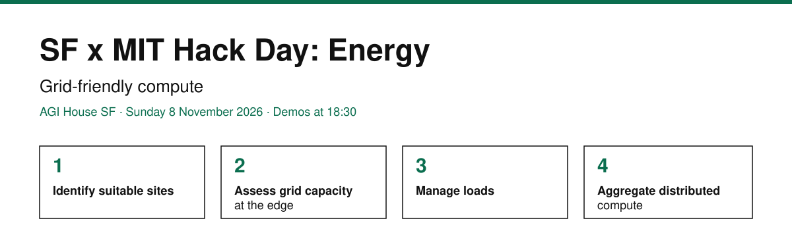

<p align="center">
  
</p>

<p align="center">
  <a href="tracks/1-sites/README.md"><b>Track 1</b></a> &nbsp;·&nbsp;
  <a href="tracks/2-grid-capacity/README.md"><b>Track 2</b></a> &nbsp;·&nbsp;
  <a href="tracks/3-load-management/README.md"><b>Track 3</b></a> &nbsp;·&nbsp;
  <a href="tracks/4-aggregation/README.md"><b>Track 4</b></a> &nbsp;·&nbsp;
  <a href="guides/ideas/README.md">Ideas</a> &nbsp;·&nbsp;
  <a href="data/README.md">Starter data</a> &nbsp;·&nbsp;
  <a href="guides/rfq/README.md">RFQs</a> &nbsp;·&nbsp;
  <a href="https://forms.gle/k1pnQ4dtvfcGkuGK6">Feedback</a> &nbsp;·&nbsp;
  <a href="guides/playbook/README.md">Schedule</a> &nbsp;·&nbsp;
  <a href="guides/playbook/prompts.md">Prompts</a> &nbsp;·&nbsp;
  <a href="tools/README.md">Open-source tools</a> &nbsp;·&nbsp;
  <a href="guides/concepts/README.md">Concepts</a> &nbsp;·&nbsp;
  <a href="guides/theme/README.md">Theme</a>
</p>

---

> **Using ChatGPT, Claude or Gemini in a browser?** Copy this into the chat:
>
> ```
> I'm at SF x MIT Hack Day: Energy on Track [1, 2, 3 or 4]. Read
> https://raw.githubusercontent.com/arhamshah08/energy-hack/main/ai/START.md
> and then the file for my track. List the most relevant open tools, datasets and papers
> (with links) for: [your idea]. Prefer ones with no API key.
> ```

Everything a team and its AI agent need to go from an idea to a working demo by **18:30**:
four tracks, ready-made problems, 300+ datasets, open-source tools, simulators, papers and programs.
Grid prices (LMP), demand and fuel mix for every US ISO: [gridstatus.io](https://www.gridstatus.io/). California feeder capacity: [PG&E GRIP](https://grip.pge.com/).

## Pick a track

| | Track | The question | Start |
|---|---|---|---|
| **1** | Identify suitable sites | Where can distributed compute get power in months, not years? | [Open →](tracks/1-sites/README.md) |
| **2** | Assess grid capacity at the edge | How much power is there, and how soon? | [Open →](tracks/2-grid-capacity/README.md) |
| **3** | Manage loads | How can compute flex without breaking service? | [Open →](tracks/3-load-management/README.md) |
| **4** | Aggregate distributed compute | How do many sites act as one grid resource? | [Open →](tracks/4-aggregation/README.md) |

**Ideas around speed to power** (permitting layer for the grid, vision models reading city permits, AI plans to speed up approvals, Omniverse grid twins and more): [ideas](guides/ideas/README.md).

**Starter data**: hourly 2025 demand and generation by fuel for the 12 largest US grid operators, one line to load: [data](data/grid-hourly-2025/README.md).

Not sure? Browse the [RFQs](guides/rfq/README.md): 22 problems people have today, each sized for one day.

## Schedule

| Time | |
|---|---|
| 10:00 | Doors, coffee, intro |
| 10:30 | Team formation |
| 13:00 | Lunch |
| **18:30** | **Demos** ([ideas](guides/playbook/demo-template.md)) |
| 19:30 | Done |

## Use it with your agent

**Coding agents** (Claude Code, Codex, Cursor, Copilot, Gemini CLI) read [`AGENTS.md`](AGENTS.md) automatically:

```bash
git clone https://github.com/arhamshah08/energy-hack
cd energy-hack
# open your agent here and tell it your track
```

**Chat agents** (ChatGPT, Claude, Gemini in a browser): use the prompt at the top of this page. Each track has a
compact file with every resource on one line:
[Track 1](https://raw.githubusercontent.com/arhamshah08/energy-hack/main/ai/track-1-sites.md) ·
[Track 2](https://raw.githubusercontent.com/arhamshah08/energy-hack/main/ai/track-2-grid-capacity.md) ·
[Track 3](https://raw.githubusercontent.com/arhamshah08/energy-hack/main/ai/track-3-load-management.md) ·
[Track 4](https://raw.githubusercontent.com/arhamshah08/energy-hack/main/ai/track-4-aggregation.md) ·
[Open-source tools](https://raw.githubusercontent.com/arhamshah08/energy-hack/main/ai/open-source-tools.md) ·
[Everything](https://raw.githubusercontent.com/arhamshah08/energy-hack/main/ai/all-resources.md)

**Search the catalog** (Python 3, nothing to install):

```bash
python3 scripts/find.py --track 2 --access open     # no-key data for Track 2
python3 scripts/find.py --track 3 --kind paper      # papers for Track 3
python3 scripts/find.py --tag simulation            # simulators for any track
```

## The theme: grid-friendly compute

Compute that connects and runs without pushing the grid past its limits, and helps the grid when
it can. Any angle that gets there fits: simulation, self-improving agents (RSI), coordination
signals, edge AI workloads, forecasting, storage, onsite generation, EV charging and
vehicle-to-grid, grid-forming microgrids, cooling and water,
reliability, markets, carbon, permitting speed, community impact, and more.
[19 example angles with starting resources →](guides/theme/README.md)

## What is in the repo

| Folder | Contents |
|---|---|
| [`tracks/`](tracks) | One page per track, with all its resources |
| [`tools/`](tools/README.md) | 110+ free open-source tools, grouped by use |
| [`data/`](data/README.md) | Starter datasets, ready to load |
| [`guides/`](guides/README.md) | Ideas, ready-made problems, concepts, glossary |
| [`ai/`](ai/START.md) | Chat-ready files for ChatGPT, Claude or Gemini |
| [`catalog/`](catalog/SCHEMA.md) | All 320+ resources as YAML and JSON |
| [`scripts/`](scripts) | Search and build |

## Feedback

Anyone can share feedback, corrections or updates through the **[Energy Hack Repo Feedback form](https://forms.gle/k1pnQ4dtvfcGkuGK6)**:
participants, people who used the repo after the event, and the creators of any tool or project listed here
(tell us if a description, credit or link is wrong). Or email **arhams@stanford.edu**.

## Contribute

Found a useful resource during the day? Add one entry to `catalog/*.yaml` and open a pull request.
See [CONTRIBUTING.md](.github/CONTRIBUTING.md). Content CC BY 4.0, scripts MIT.
