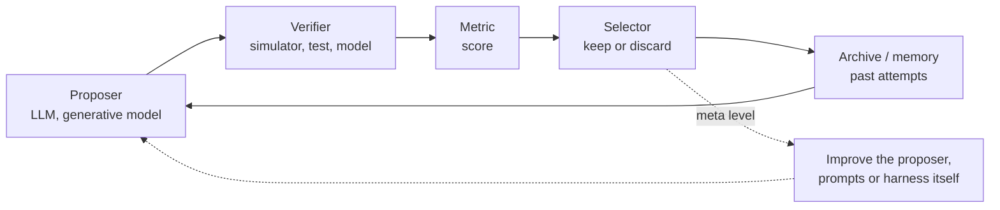

[← Front page](../../README.md) &nbsp;·&nbsp; [Feedback form](https://forms.gle/k1pnQ4dtvfcGkuGK6)

# RSI: recursive self-improvement

## 1. Definition

| # | Term | Meaning |
|---|---|---|
| 1 | Self-improvement | A system changes something about itself (prompt, memory, tools, code, weights) and keeps the change if a score goes up |
| 2 | Recursive | The thing being improved includes the improvement process, so each round can make the next round better |
| 3 | Bounded RSI | Agents edit prompts, tools, scaffolding or code toward goals and metrics set by people. Demonstrated today |
| 4 | Full RSI | A system redesigns its own weights or architecture without limit. Not demonstrated as of Nov 2026 |

## 2. Loop anatomy

| # | Component | Catalog role tag | Examples in this repo |
|---|---|---|---|
| 1 | Proposer | `proposer` | `mattergen`, `openevolve`, `funsearch` |
| 2 | Verifier | `verifier` | `pybamm`, `mace`, `pandapower`, `grid2op`, `torax`, `vessim` |
| 3 | Metric | `metric` | `matbench-discovery`, `pglib-opf`, `buildingsbench`, `mle-bench` |
| 4 | Data | `data` | `materials-project`, `eia-930`, `matr-battery` |
| 5 | Harness | `harness` | `aideml`, `autoresearch`, `dspy`, `gepa`, `dgm`, `shinkaevolve` |

`python3 scripts/find.py --role harness` lists every loop framework.

## 3. Levels at which a loop can improve

| # | What changes between rounds | Known examples |
|---|---|---|
| 1 | The candidate (a material, a schedule, a program) | FunSearch, AlphaEvolve, GNoME active learning |
| 2 | The prompt or pipeline | DSPy, GEPA |
| 3 | Memory of past attempts | Reflexion, Voyager skill library |
| 4 | The agent's own code or scaffold | STOP, Self-Improving Coding Agent, Darwin Godel Machine |
| 5 | The improver of the agent | AIDE2 outer loop, Hyperagents (preprints) |
| 6 | Model weights | Self-generated training data and RL post-training |

## 4. Why simulation matters here

From the event page: "a lot of it can be tested in simulation before anyone touches hardware.
We want agents that do that testing and get better at it each run." A verifier that runs in
seconds lets a loop run hundreds of rounds in a 5-hour hack. A verifier that takes hours allows a
handful.

| # | Verifier speed (typical, CPU) | Examples |
|---|---|---|
| 1 | Milliseconds to seconds | `pandapower` power flow, `pybamm` SPM, ML potentials on small cells |
| 2 | Seconds to minutes | `torax` runs, `grid2op` episodes, `pypsa` small models |
| 3 | Hours or more | DFT, full-year capacity expansion, high-fidelity MHD |

## 5. Known failure modes

| # | Failure | What happens |
|---|---|---|
| 1 | Reward hacking | The loop finds ways to raise the score that do not reflect real improvement |
| 2 | Overfitting to the verifier | Candidates exploit simulator errors; results fail in reality (sim-to-real gap) |
| 3 | Eval leakage | Test data reaches the proposer, so scores overstate ability |
| 4 | Collapse of diversity | The archive fills with near-copies; novelty filters (ShinkaEvolve, DGM archive) address this |
| 5 | Compute cost | Each round costs model calls plus verifier runs |
| 6 | No transfer | Gains on one task do not carry to others; AIDE2 and DGM report transfer, both preprints |

## 6. Organisers working on RSI

| # | Group | Focus (from the event page) |
|---|---|---|
| 1 | RSIhouse.ai | Weekly hacks on post-training, evals, harness engineering, self-play, swarm intelligence |
| 2 | Autolab.ai | Eval infrastructure for autonomous continual learning |
| 3 | Superradiant | Self-improving agents applying advances in mathematics to the sciences |

## 7. Reading

`python3 scripts/find.py --domain rsi --kind paper` lists the papers. Start points:
`funsearch-2023`, `dgm-2025`, `alphaevolve-2025`, `gepa-2025`, `autolab-2026`, `attia-2020`.
